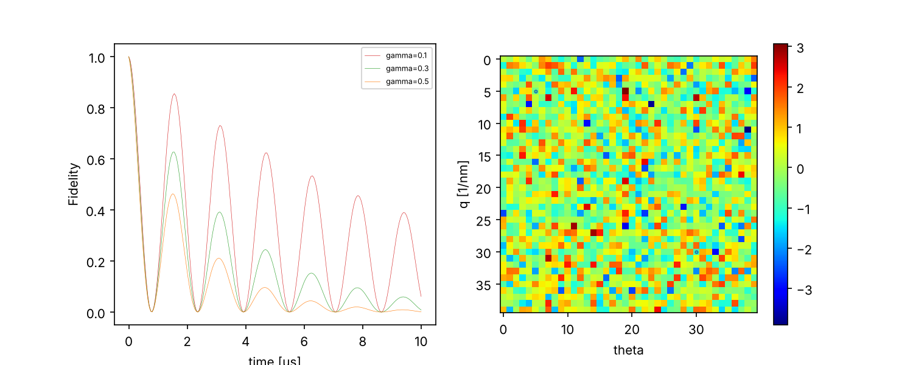
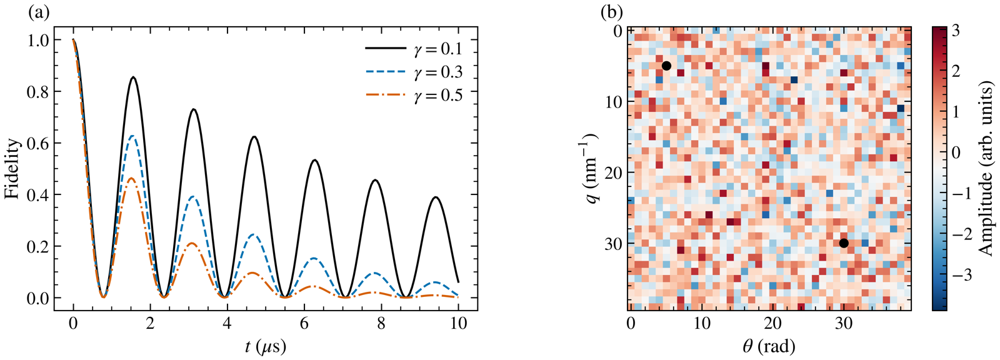

# prx-figure

An [Agent Skill](https://agentskills.io) that re-plots existing matplotlib figures to meet
the **Physical Review X / APS Physical Review** figure requirements, and audits figures
against those rules.

It works with any agent that supports the open `SKILL.md` format, including Claude Code,
OpenAI Codex, Gemini CLI and Cursor. The Python helpers also work on their own, without
an agent.

| Before | After (double column, 0 audit errors) |
|---|---|
|  |  |

## What it does

The agent finds the script or data behind each figure, audits it, writes a restyled copy
(`<name>_prx.py`, never overwriting the original), re-audits until there are no errors,
and saves `.pdf`, `.eps` and 600 dpi `.png` at the exact column width. If a figure exists
only as an image, it asks for the data instead of tracing or stretching the picture.

Rules enforced, from [APS Style Basics](https://journals.aps.org/authors/style-basics):

| Rule | Check |
|---|---|
| Width: 8.5 cm (3 3/8 in) single column; 1.5 or 2 columns for detailed figures | `prx.figsize("single" \| "onehalf" \| "double")` |
| Smallest capitals and numerals at least 2 mm tall at final size | measured from the actual font's cap height |
| Data points at least 1 mm; curves at least 0.5 pt | markers, scatter sizes, lines, error bars |
| Avoid small open symbols, shading, cross-hatching | flagged |
| Units in parentheses, not square brackets; Greek symbols, not spelled-out names | axis labels checked |
| Multipanel figures labeled (a), (b), ... | `prx.panel_labels()`; presence checked |
| Accessible colors, distinguishable in grayscale | Okabe-Ito colors paired with line styles; grayscale look-alike check; `jet`/`rainbow` flagged |
| EPS/PS for color-online figures | `prx.save()` writes EPS, PDF and PNG |

## Install

Clone into the skills directory of each agent you use:

```bash
# Claude Code (personal)
git clone https://github.com/KMWphys/prx-figure ~/.claude/skills/prx-figure

# OpenAI Codex (personal)
git clone https://github.com/KMWphys/prx-figure ~/.agents/skills/prx-figure
```

For one project only, use `.claude/skills/` or `.agents/skills/` inside the repository.
To keep a single copy, clone once and symlink it into the other directory (if an agent
doesn't pick up the symlink, copy the folder instead).

Requirements: Python 3.9+, `matplotlib`, `numpy`. LaTeX is optional.

## Use with an agent

Ask in plain language, for example:

> Make the figures in `figs/` PRX style. Fig. 2 should be double column.

The agent loads the skill automatically when the request matches. In Claude Code you can
also invoke it directly with `/prx-figure`.

## Use without an agent

Audit an existing plotting script without changing it (its `savefig` calls are blocked,
so nothing on disk is overwritten):

```bash
python scripts/audit_figure.py path/to/plot.py --width double
```

Use the helper in your own script:

```python
import sys; sys.path.insert(0, "/path/to/prx-figure/scripts")
import matplotlib.pyplot as plt
import prx_style as prx

prx.apply()                                  # style sheet; prx.apply(usetex=True) for Computer Modern
fig, axes = plt.subplots(1, 2, figsize=prx.figsize("double", aspect=0.36))
# ... plotting code ...
prx.panel_labels(axes, outside=True)         # (a), (b)
prx.audit(fig, width="double")               # prints problems; returns a list
prx.save(fig, "figs/fig2")                   # fig2.pdf, fig2.eps, fig2.png
```

Or just the style sheet: `plt.style.use("/path/to/prx-figure/assets/prx.mplstyle")`.

`examples/plot_before.py` and `examples/plot_after.py` reproduce the images above.

## Layout

```
SKILL.md                     instructions the agent reads
references/aps-figure-rules.md   rule table with numbers
assets/prx.mplstyle          matplotlib style sheet
scripts/prx_style.py         apply / figsize / panel_labels / audit / save
scripts/audit_figure.py      audit an unmodified plotting script
examples/                    before/after demo
```

## Notes

- APS states only the single-column width. The 1.5-column (5.0 in) and double-column
  (7.0 in) widths follow the REVTeX two-column layout; check the current PRX template if
  the exact width matters.
- The default font is STIX (Times-like) and needs no LaTeX. `usetex=True` matches REVTeX's
  Computer Modern body text.
- EPS has no transparency, so check EPS output when a figure uses `alpha`.
- The audit cannot judge overlap, clutter or whether symbols are defined in the caption;
  look at the output.

## License

MIT
